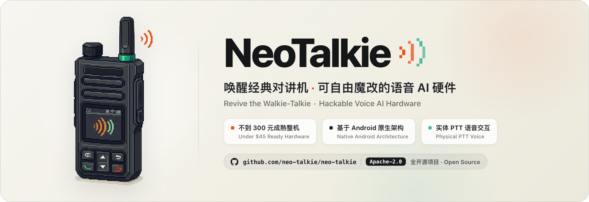

<p align="center">
  
</p>

# NeoTalkie

**把一台不到 300 元的安卓对讲机，变成开箱即用、可自由魔改的 AI 硬件——尤其为语音交互而生。**

> An open-source, pixel-styled device software suite that turns an off-the-shelf Android walkie-talkie into a genuinely fun, voice-first hackable AI hardware platform.

[为什么做](#为什么做-neotalkie) · [演示](#演示demo) · [硬件与购买](#硬件与购买渠道) · [项目与架构](#项目内容与架构) · [快速启动](#快速启动) · [维护与合作](#维护与开源说明)

---

## 为什么做 NeoTalkie？

今天想亲手折腾一台好玩的 AI 硬件，很多开发者第一步就得面对一长串硬件工程：选开发板、买麦和喇叭、焊模块、画外壳、3D 打印、反复拼装调试……真正写代码做有趣玩法之前，大量精力就已经消耗在“把一台能用的机器攒出来”这件事上了。

但其实，市面上早就有现成的宝藏级成品——**300 元以内的安卓公网对讲机**。

这类小屏安卓手台长期活跃在**海外出口市场**，原本主要给海外用户安装 Zello 等公网对讲应用。它在国内大众市场从未火过，在全球创客与开源硬件圈里也几乎没人留意过。但当我们真正拿到手里、深入折腾完之后，非常有信心告诉大家：**这是一台被严重低估的宝藏硬件，完全值得作为你折腾 AI 硬件的第一块底座！**

- **天生适合语音交互，久经验证的经典形态**：作为一台可自由魔改的 AI 硬件，它**尤其适用于语音交互**。对讲机的整个外形设计与工程原理——单手盲操握持、拇指自然贴合的侧面大 PTT 键、按住说话松手发送的清晰交互边界、专为人声外放调校的大功率声学腔体与物理音量旋钮——本身就是几十年来在无数真实场景中**久经验证的语音交互形态**，比解锁手机找按钮或依赖容易误触发的唤醒词顺手得多。
- **开箱即用的满配成品，省掉所有硬件拼装烦恼**：无需画板、无需 3D 打印、无需手动组装。买回来就是一台工业设计拉满的成熟整机——扎实趁手的机身质感、超爽的实体按键与旋钮手感、顶格电池续航，再加上齐全的 Wi-Fi / 蓝牙 / 蜂窝通信与音频硬件。个人 DIY 几乎不可能用这么低的成本做出这样的完成度。
- **原生 Android 底子，上手极易、折腾上限极高**：它不是封闭受限的单片机，而是一台正经跑 Android 的设备（当前主力验证机型为 Android 5.1）。插上 USB 就能 ADB 调试、写原生代码、自由装 APK——从零上手的门槛极低，但可玩性和扩展上限几乎没有天花板。

过去，这类设备一直安静地服务于传统公网对讲场景，**还没有人真正去关注过：如何把这块小屏、这组实体按键和整套安卓底子的潜力发挥到最佳，把它变成 AI 时代更好玩的东西。**

于是我们做了 **NeoTalkie**，为这台好硬件打开全新的玩法空间：

- **专为 160×128 小屏打造的像素风 UI**：充分挖掘微型屏幕的视觉表现力，全面采用高对比度像素风设计，所有页面严格围绕无触屏单列实体按键与旋钮打造，让每一次按键和旋钮反馈都充满复古又硬核的操控感。
- **把配网与配置体验彻底做顺**：不用在迷你按键设备上费劲输入 Wi-Fi 密码和 API Key。桌面内置前台 BLE 物理授权配网与亮屏自动发现的加密局域网管理服务，配合微信小程序助手，几秒钟搞定联网、模型密钥、频道切换与问答记录查看。
- **上手即用、真正好玩的 AI 与音频应用**：
  - 按下实体 PTT 就能秒速发起 **AI 语音对讲**，下侧键一键切换不同角色/频道，带上下文追问主题与播报时长控制；
  - 打开 **音频互联（Audio Link）**，手台瞬间变身手机/电脑的**蓝牙小音箱 + 实体 PTT 无线麦克风**，甚至支持 **Mac `Fn` 首尾点按模式**，无缝联动电脑语音输入！

免去硬件拼装的繁琐，直接站在一台成熟成品的肩膀上——传统对讲机 × 像素风交互 × AI 语音 × 蓝牙桌面外设，这就是我们心目中 AI 时代真正好玩、低门槛、高上限的**可自由魔改 AI 硬件**。

---

## 演示（Demo）

> 🎬 **演示视频即将上线**：以下位置预留给实机录制的 Demo 视频与动图，直观展示这台不到 300 元的安卓手台都能怎么玩。

| 玩法场景 | 演示内容 | 演示视频 / 预览 |
| --- | --- | --- |
| **像素风桌面与实体交互** | 160×128 纯像素风桌面、上下键单列导航、物理音量旋钮与底部像素音量条 | _待补充（视频链接）_ |
| **PTT 一键 AI 语音对讲** | 按住侧面 PTT 唤醒对讲（ASR → LLM → TTS）、下侧键轮换频道、上下文追问与退出控制 | _待补充（视频链接）_ |
| **手机 BLE 配网与后台管理** | 手台「手机配置」BLE 物理授权加密配网、亮屏局域网自动重连、修改模型/频道与查看记录 | _待补充（视频链接）_ |
| **Audio Link 音频互联** | 变身手机/电脑蓝牙小音箱，按住 PTT 作为无线麦克风，以及联动 Mac `Fn` 语音输入 | _待补充（视频链接）_ |

<!-- TODO: 在上方表格或下方直接嵌入 GitHub 视频链接 / Bilibili / YouTube 演示链接 -->

---

## 硬件与购买渠道

### 当前主力适配机型

NeoTalkie 目前在 **`mx_b5`** 平台完成主要开发与真机验收：

- **系统与芯片**：Android 5.1.1（MSM8909）
- **屏幕与交互**：160×128 横屏、**无触屏**、纯实体按键（侧面大 PTT 键、上/下侧键、MENU / EXIT、顶部音量旋钮）
- **无线与音频**：Wi-Fi（2.4GHz）、经典蓝牙 + BLE、大音量扬声器与麦克风

> 其他同类安卓手台同样欢迎自行探索适配——核心玩法、频道与通信协议均可复用，通常只需核对新机型的实体按键键值、PTT 厂商广播、系统权限和蓝牙属性差异。

### 硬件背景、厂商与购买途径

这类安卓公网对讲机原本主要面向海外出口市场（常见用途是配合 Zello 进行公网对讲），供应链和整机做工已经相当成熟，但在国内个人市场和全球创客社区一直很少被提及，直接选购同款并不容易。

- **硬件厂商说明**：_待补充（后续完善合作厂商背景与具体型号辨识要点）_
- **淘宝购买渠道**：_链接待补充 — 我们正在对接方便的购买方式，后续会在此放上可直接入手同款机器的淘宝店铺链接。_
- **省心上手小贴士**：下单时可以直接**备注或联系卖家帮忙提前刷好 NeoTalkie 固件**——到手开机、配上网就能立刻体验，省去首次折腾环境与刷机的门槛，大大降低第一次上手的成本；等你想自己魔改时，再插上数据线刷入自己编译的版本即可。

<!-- TODO: 补充硬件厂商介绍及淘宝购买链接 -->

---

## 项目内容与架构

本仓库（[`neo-talkie`](https://github.com/neo-talkie/neo-talkie)）是**纯设备端开源软件与开发工具仓库**，不包含任何平台后台、云端部署、账号数据库、私有密钥或用户录音。语音识别、大模型与语音合成均由你自行配置外部服务 API。

### 三个可安装的 Android 应用（APK）

三个应用均基于原生 Java + Android SDK 编写，共用同一份本地签名，进程与私有数据完全隔离：

| 应用 | 目录 | Android 包名 | 职责与核心能力 |
| --- | --- | --- | --- |
| **NeoTalkie 桌面** | [`android/launcher/`](android/launcher/) | `com.neotalkie.launcher` | 自定义像素风 HOME 桌面、应用入口、设备/网络状态页、Android 系统设置入口；负责前台 BLE 物理授权配网、亮屏 BLE 地址广播与局域网加密后台管理（`ManagementService`），以及签名保护的跨应用 PTT 交接。**不持有语音密钥，也不申请麦克风权限。** |
| **NeoTalkie 对讲** | [`android/talk/`](android/talk/) | `com.neotalkie.talk` | 核心 AI 语音对讲应用。支持实体 PTT 唤醒采音、ASR → AI → TTS 完整链路、多频道配置与下侧键（`F8`）快速轮换、短期上下文与每轮 `<topic>` 追问主题、按频道限制播报时长（30/60/120 秒）、本地最近 100 条文字记录与用量统计，以及语音服务连通诊断。 |
| **NeoTalkie Audio Link（音频互联）** | [`android/audio-link/`](android/audio-link/) | `com.neotalkie.hfpmic` | **可选包（mx_b5 专用）**。打开应用即启用 A2DP 媒体播放接收与 HFP 免提麦克风角色，手机或电脑连上即可播放音乐；按住 PTT 传音、松手静音，支持**普通 PTT** 与 **Mac `Fn` 首尾点按**（HID 键盘发送 Globe/Fn）两种模式，媒体与通话共用底部音量条；离开应用自动关闭并恢复原蓝牙角色。 |

### 共享代码、配置与仓库结构

| 目录 | 职责说明 |
| --- | --- |
| [`android/common/`](android/common/) | 编译期共享的原生 Java 源码（像素风 UI 渲染、公共底部音量条 `VolumeStrip`、息屏/唤醒控制、单列导航与 PTT 状态机）。不是独立 APK，也不存配置或密钥。 |
| [`android/scripts/`](android/scripts/) | 纯 Python 构建、离线单测、依赖下载（SHA-256 校验）、ADB 安装/状态检测与配网脚本。**无 Gradle，构建 APK 不依赖 Node 运行时。** |
| `config/` | 共享 UI 契约（`config/radio-ui/`，文案、像素图形、布局与回归场景的单一事实源）、默认系统 Prompt（`config/prompts/`）以及空模板配置示例（`config/device.example.json`）。 |
| [`tools/`](tools/README.md) | 电脑端开发与回归校验工具，拥有独立的 `tools/package.json`：`tools/simulator/` 为离线手台模拟器与设计工作台固定发行版，`tools/ui/` 负责生成 Java/JS 契约代码与像素视觉回归检查，`tools/scripts/` 负责开源内容预检。 |
| `docs/` | 完整的架构、新设备启用、BLE 配网协议、配置服务约定、UI 契约、模拟器与真机验收文档。 |

```text
neo-talkie/
├── android/                Android 工程（原生 Java + Android SDK，无 Gradle）
│   ├── launcher/           NeoTalkie 桌面 APK（com.neotalkie.launcher）
│   ├── talk/               NeoTalkie 对讲 APK（com.neotalkie.talk）
│   ├── audio-link/         可选的 mx_b5 音频互联 APK（com.neotalkie.hfpmic）
│   ├── common/             编译期共享的 Java 源码（UI / 音量条 / 电源 / PTT 契约）
│   └── scripts/            构建、离线测试、依赖校验与 ADB 工具
├── config/                 共享 UI 契约、默认 Prompt 与公开配置示例
├── tools/                  电脑端开发工具（独立 package.json 与锁文件）
│   ├── simulator/          离线手台模拟器与设计工作台固定发行版
│   ├── ui/                 UI 契约生成、Java/JS 一致性与视觉回归检查
│   └── scripts/            开源清单与敏感信息检查
├── docs/                   架构、启用、协议、UI 与真机验收文档
└── Makefile                跨工程统一命令入口
```

> **工程边界提示**：仓库根目录不是 Node 项目（没有根 `package.json`）。`make setup` 只安装 `tools/node_modules` 供 UI 契约与模拟器工具使用，Android 构建本身不依赖 Node。本机生成的 `.tools/`（JDK/SDK 与构建依赖缓存）、`data/`（私有配置、本地开发签名与验收产物）和 `android/*/build/`（APK 产物）均已 `.gitignore`，覆盖升级时请保留本机签名。

### 设计体系与 Design Studio

对创客硬件来说，**好的交互与视觉体验绝不是锦上添花，而是硬件真正好用、让人爱不释手的核心前提**。但在 160×128 这样的微型点阵屏上做设计，如果每次微调像素、字体或状态反馈都要重新打包、刷机、肉眼对着真机猜效果，体验很快就会在反复妥协中垮掉。

为了方便大家在自己魔改和开发的过程中也能把设计做扎实，我们**坚决随项目提供一整套设计资源包与 Design Studio（手台设计工作台）**，帮你把完整的设计现场直接还原到电脑屏幕上：

- **Design Studio（手台设计工作台与交互模拟器）**：内置在 [`tools/simulator/`](tools/simulator/README.md)（独立设计工作台发行副本），无需连真机、无需密钥，在电脑浏览器里就能按应用分组走查全部页面的设计基准稿，还支持导入 Android 真机截图做**并排与叠加比对**。工作台同时内置带机身和实体按键的交互模拟器，支持 160×128 原始点阵与整数倍放大网格预览、按键/旋钮/PTT 交互推演与状态图册导出。
- **单一事实源的 UI 契约与视觉回归**：所有像素元素、配色、布局坐标、文案、计时规则和 170+ 命名场景都沉淀在 `config/radio-ui/`，通过 `make ui-generate` 同步生成 Android 端与浏览器端代码，并可用 `make ui-visual` / `make ui-check` 自动出图比对差异。无论是你自己调界面，还是让 AI 帮你改 UI，都可以先在 Design Studio 里把像素级细节走查到位，再刷入真机。

> 🖼️ **设计组件与理念总览图（占位）**
>
> _待补充：后续将在此展示 NeoTalkie 的像素风设计组件、图标与状态元素、160×128 屏幕网格规范以及 Design Studio 走查界面截图。_

<!-- TODO: 替换为设计资源包 / Design Studio 组件与理念展示图 -->

更多细节见 [UI 一致性契约](docs/radio-ui-contract.md) 与 [手台界面模拟器](docs/radio-simulator.md)。

### 直连云厂商：零中间商，自带 Key

NeoTalkie 是一个**彻底开源、去中心化**的设备端项目：手台里的语音对话能力全部**直连云厂商**，**没有任何中间商，也没有中心化平台代管你的付费 Key**——全部由你自己配置自己的 API Key 来使用。

我们坚持“直连 + 自带 Key（BYOK）”架构，核心出于三个原因：

- **极致低延迟（Every second matters）**：语音对讲是极度看重即时响应的交互，多绕一层中转服务器就会白白多出网络往返与排队耗时。为了把从松开 PTT 到听见回答的整套对话体验做到最佳、把延迟压到最低——**每一秒都至关重要（Every second matters）**，直连云厂商是最干脆、最高效的选择。
- **安全性最有保障**：没有中心化后台转发或托管你的密钥，也没有云端账号体系替你存对话与录音；所有 API Key 仅保存在你自己手台的本地私有目录中，数据只在你的设备与你选择的云厂商之间直连流转。
- **Token 计费透明友好**：没有中间商差价、没有二次抽成或强制套餐，直接按云厂商官方定价用多少付多少，每次对话的真实 Token 消耗与耗时都会记录在手台本地供随时核对。

> 🔑 **开通指南（链接占位）**：《3 分钟在火山引擎开通你所必要的这些 Key》——_链接待补充，后续将在此挂载完整图文教程，带你快速拿到语音服务 Key（`voiceApiKey`）、火山方舟 Key（`arkApiKey`）以及模型 / Endpoint ID，填进手台即可直接开聊。_

<!-- TODO: 替换为《3 分钟在火山引擎开通你所必要的这些 Key》文档链接 -->

### 关于微信小程序助手

为了把配网、填密钥、管理频道和查看历史记录这些在无触屏小屏上不方便完成的操作做到顺手，NeoTalkie 配套了一个微信小程序助手。关于它的开放边界，这里提前和大家说明白：

- **小程序源码暂不开放**：出于**安全与线上运营**等方面的考量，微信小程序本身的代码不对外开源。如果你希望自己掌控完整的手机端交互，仓库已经公开了设备端全部的 [BLE 配网与局域网管理协议](docs/ble-provisioning.md) 和 [手台配置服务约定](docs/device-configuration.md)，完全可以按协议自己实现一个手机 App、小程序或桌面配置端。
- **不影响你自由使用与深度折腾这台硬件**：
  - **日常配网直接用现成的即可**：需要连 Wi-Fi、配模型或切频道时，直接打开手台「手机配置」，用微信小程序完成配网即可，拿不到小程序源码并不影响开箱体验；
  - **设备端软硬件完全由你掌控**：手台上跑的全部 APK、UI 契约与构建脚本都在这里完全开源，想改什么功能、做什么新应用，直接写完代码刷进设备就行；
  - **多种极客方式任你发挥**：就算完全绕开小程序，也可以直接通过 USB ADB 脚本（`android/scripts/provision.py`）、手台自带的 Android 系统设置，或者按公开协议自己写脚本在局域网里对接设备。无论怎么玩，这台硬件依然高度开放、足够可折腾。

---

## 快速启动

### 一键复制 Prompt，让你的 AI 直接开工

克隆仓库后，用你顺手的 AI 编程助手（Claude Code、Codex、Cursor 等）打开本项目，**直接复制下面两行 Prompt 丢给它**——仓库里的开发规范、硬件特性、踩坑记录和构建流程都已经整理成了清晰文档，AI 读完就能带你一步到位。

**1）新机上手：检查环境、编译 APK 并刷入已连接的手台**

```text
请先阅读 AGENTS.md、docs/getting-started.md、docs/architecture.md 和 docs/verification.md，掌握本项目的硬件特性、按键/蓝牙踩坑记录与构建规则。
然后帮我检查本机 JDK/Android SDK 环境，完成依赖准备、离线构建与测试，并引导我通过 ADB 将 APK 安装到已连接的手台。
```

**2）二次开发与魔改：基于现有架构给手台加新功能或改像素界面**

```text
请先阅读 AGENTS.md、docs/architecture.md、docs/radio-ui-contract.md 和 docs/verification.md，了解无触屏实体按键规范、共享音量条、Design Studio 走查流程及 mx_b5 硬件踩坑经验。
我想基于这套底座给手台实现【在这里写下你的想法，例如：一个像素风番茄钟 / 自定义按键快捷工具】，请先给我拆解方案并开始开发。
```

### 手动构建与离线测试

如果你想自己手动跑命令行，先按 [新设备启用](docs/getting-started.md) 准备好 JDK 17 与 Android SDK（`android-28`、`build-tools;35.0.0`、`platform-tools`），然后运行：

```sh
make setup
python3 android/scripts/setup.py
make android-build
make test
```

- `setup.py` 仅下载并校验公开 Java 依赖（SHA-256）。
- `make test` 全程离线运行，不连接任何外部语音或大模型服务。
- 构建产物：
  - `android/launcher/build/neotalkie-launcher.apk`
  - `android/talk/build/neotalkie-talk.apk`
  - `android/audio-link/build/neotalkie-audio-link.apk`

### 上手小贴士

- **手机配网与管理**：在手台桌面打开 **「手机配置」**，用微信助手通过 BLE 扫描连接、核对两端确认码并按 `MENU` 物理授权即可完成配网。开启后台管理后，手台亮屏即可经同一 Wi-Fi 自动重连，随时修改模型、密钥、频道或拉取最近 100 条问答与用量。详见 [BLE 配网与局域网管理](docs/ble-provisioning.md)。
- **音频互联（Audio Link）**：在手台打开 **「音频互联」**，上下键选中 **「蓝牙配对」** 按确定（120 秒可发现窗口），手机或电脑连接后即可当作蓝牙音箱播放媒体，按住 PTT 作为麦克风传音，并可切换到 **Mac `Fn` 首尾点按** 模式。详见 [音频互联说明](android/README.md#neotalkie-audio-link音频互联)。

### 完整文档

- **入门与上手**：[开发总览与约束](AGENTS.md) · [新设备启用](docs/getting-started.md) · [Android 工程与音频互联说明](android/README.md) · [开发工具](tools/README.md)
- **架构与协议**：[系统架构与模块边界](docs/architecture.md) · [BLE 配网与后台管理](docs/ble-provisioning.md) · [手台配置服务约定](docs/device-configuration.md) · [OTA 静默更新与发布流水线](docs/ota.md) · [项目 Backlog](docs/backlog.md)
- **界面与校验**：[UI 一致性契约](docs/radio-ui-contract.md) · [离线模拟器](docs/radio-simulator.md) · [场景目录](docs/radio-simulator-states.md) · [真机验收记录](docs/verification.md)

---

## 维护与开源说明

### 开发声明与维护规则

为了让大家在探索和参与项目时有清晰的预期，这里把我们的开发方式与协作原则直接说透：

- **🤖 AI 协作开发声明**：本项目的代码由**人工设计把关 + AI 协作**共同完成，**代码主体主要由 AI 编写**。我们非常拥抱这种开发范式，也**强烈鼓励你同样借助 AI** 来阅读仓库、适配你手里的新设备、修复问题，或者给手台魔改出完全意想不到的新玩法！
- **📝 文档优先，最欢迎硬件踩坑经验**：在社区协作中，我们**优先维护仓库里的 Markdown 文档**。相比大段功能代码，我们更希望能一起沉淀**真实硬件相关的知识与踩坑经验**——比如某款安卓手台哪些地方特别香、哪些地方很坑、实体按键的键值与 ROM 广播特性、蓝牙/音频链路怪癖、不同固件的权限差异等。**这类由大家亲手实测、人工整理沉淀的硬件经验文档 PR，我们会优先审阅并合并。**
- **🔧 代码维护边界**：受限于维护者的时间与精力，功能性代码 PR 我们**只会接收并合并极高优先级的一部分关键修复**；其余功能建议、新需求或一般性 PR 不一定能够逐一回复，还请大家多多包涵。

**核心理念始终只有一句话：自己动手，尽情折腾！** 把 NeoTalkie 当作你的起跑线，叫上你的 AI 助手，去把它改成你最想要的随身 AI 硬件吧。

### 开源协议

本项目采用 **[Apache License 2.0](LICENSE)** 开源协议，欢迎自由使用、修改、二次开发与分发。

各应用引入的第三方组件与字体许可声明分别保留在对应目录的 `THIRD_PARTY.md` 和 `assets/NOTICE` 中。

### 联系与合作

我们非常欢迎更多硬件厂商与供应链伙伴提供合适的设备接入 NeoTalkie，一起探索 AI 时代高可玩性硬件的更多可能。

如果你手上有合适的安卓手台、便携音频设备或相关合作想法，欢迎发邮件联系：

- **联系邮箱**：`ottomao[at]gmail.com`（发信时请将 `[at]` 替换为标准邮箱分隔符）
